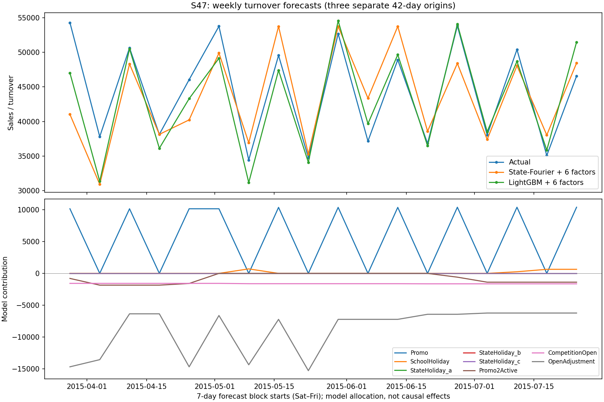

# 六因子真实零售实验：State-Fourier 与 LightGBM

**不是合成数据。** 使用Rossmann原始营业额及业务字段，保持旧实验的400家门店、验证原点774、测试816/858/900、42天步长。模型及网格在本次运行前写入 `audit/results/rossmann_review/protocol.json`。旧测试已被查看，因此是探索性回测，不是新的盲测。

## 六类因子

| 因子组 | 来源与处理 |
|---|---|
| 短期促销 | 原始 Promo；仅有二元标记，没有促销强度或满减/折扣类型 |
| 营业状态 | 原始 Open；作为营业开关，闭店输出0 |
| 学校假期 | 原始 SchoolHoliday |
| 法定节假日 | 原始 StateHoliday 的 a/b/c 类型，三个哑变量只算一个因子组 |
| 持续促销计划 | Promo2SinceYear/Week 与 PromoInterval 推导活动月份；只对预测原点已参加计划的门店生效，是计划代理变量 |
| 竞争店开业状态 | CompetitionOpenSinceYear/Month 推导；未来42天冻结为预测原点的状态，不提前使用未来开店事件 |

没有把同一日历字段拆成多个哑变量凑够因子数量，也没有使用未来Customers。竞争开店日期缺失时编码为0（未知/未确认已开业），不能解释为确定无竞争。静态门店类型、商品组合、竞争距离不放进逐店State-Fourier，以免与水平项混淆；新的LightGBM对照也不使用这些额外静态属性，只保留门店ID、历史、日历和相同六类外因。

营业、短促和假期按已知计划评估，数据没有当时版本的计划；Promo2与竞争资料同样来自单次静态快照，历史可得性无法完全验证。这是有条件的回顾性效果，不是业务上线保证。

## 模型与验证

模型：y_it = Open_it × [level_it + Fourier7_it + β_iᵀ x_it] + ε_it。按店保留完整联合协方差，Kalman更新水平、季节与回归系数；β为静态未知系数，先验零均值收缩。沿用原Rossmann模型无趋势的设定。营业状态通过观测设计参与训练，闭店记录不把营业日水平拉向零。它是已有状态空间回归的扩展，不是新的MPA算法。

用验证窗口选择 qr∈{0.002,0.02,0.2}、β先验方差∈{0.1,1}，选中 qr=0.02、β方差=0.1；所有因子消融重训但固定此配置。LightGBM沿用原验证选出的600棵树，无外层择优。不同模型的调参空间、跨店共享方式与非线性能力不同，不能把差距只归因于推断器。

## 主结果

| 模型 | 平均 WAPE | 三个原点 WAPE |
|---|---:|---|
| State-Fourier：无外因 | 25.6436% | 31.214% / 24.659% / 21.059% |
| State-Fourier：仅营业状态 | 19.7759% | 23.530% / 16.167% / 19.631% |
| State-Fourier：六因子 | 11.6335% | 13.264% / 10.415% / 11.222% |
| LightGBM：相同六因子 | 9.2449% | 10.488% / 8.883% / 8.363% |

平均WAPE按门店、窗口等权。未引入未来目标进行滤波更新，整个42天一次性预测。无外因版本与旧State-Fourier数值等价已通过测试；新结果文件单独保存，旧榜单未被替换。

## 哪些因子有用：固定超参逐组去除

| 去除的因子 | 去除后 WAPE | 相对完整六因子的变化 | 门店聚类95%区间 |
|---|---:|---:|---|
| without_open | 15.2174% | +3.5839pp | [+3.4101, +3.8082]pp |
| drop_promo | 19.9015% | +8.2679pp | [+7.9847, +8.5490]pp |
| drop_school | 11.6476% | +0.0141pp | [-0.0239, +0.0543]pp |
| drop_state_holiday | 11.6511% | +0.0176pp | [+0.0070, +0.0300]pp |
| drop_promo2_active | 11.5521% | -0.0814pp | [-0.1075, -0.0542]pp |
| drop_competition_open | 11.6335% | -0.0000pp | [-0.0009, +0.0008]pp |

主要收益来自短期促销和营业信息。学校/法定假期增量很小，竞争开业状态在当前配置下几乎无增量；去掉持续促销代理略好，但不能根据此测试结果事后删除后再称独立验证提升。因子相关、参数会重新拟合，消融差不能相加，也不是因果效果。区间按门店保留全部三个窗口，仍不能覆盖跨店共享节日冲击与未来新窗口的不确定性。

## 贡献曲线与可辨识性

保存全部400家店×18周的贡献表：[weekly_contributions.csv](audit/results/rossmann_multifactor/weekly_contributions.csv)。展示店 S47 是按训练期Promo2/竞争状态均有变化的首个ID选择，不按预测好坏挑选。每个窗口的6个块均为周六至周五；相邻窗口重新训练，曲线不是一次连续126天预测。



完整加和：基础水平 + 周期 + 五类回归项 + 营业调整 + 非负截断调整 = 最终预测。营业调整在闭店时等于负的未关店预测，属于结构规则，不是实验估计的关店损失。CSV保留基础水平和周期，图下半部只展示业务贡献。

六类输入不意味着每家店六类都可单独识别。在验证前训练期，Promo2在185家店变化、竞争状态只在52家变化；节假日常与闭店同时出现，对营业日节假日效应的数据支持更少。恒定因素与水平项重叠，收缩先验只能给出一种模型分配，不能创造因果识别。营业日上的变化覆盖见 summary.json。

## 下一步

先在新的业务时间窗口、真实计划版本上检验；若研究改进，优先考虑促销强度/类型和促销×星期的交互或跨店系数共享。当前六因子State-Fourier比单变量明显改善，但在三个窗口均未达到同信息集LightGBM的误差水平，不能宣称更高预测精度。

复现：

```bash
python repro/alt/fetch_rossmann.py
OPENBLAS_NUM_THREADS=1 python repro/alt/bench_multifactor.py
python repro/alt/report_multifactor.py
```
